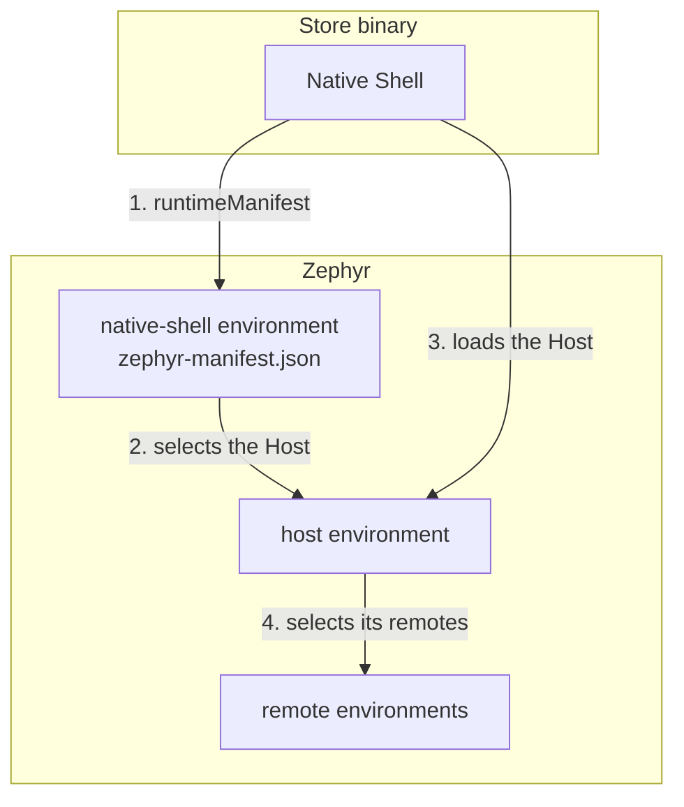

import { PackageManagerTabs } from '@rspress/core/theme';

# React Native Shell + Host Architecture (Beta)

In the usual Metro Module Federation setup, the host app ships inside the store binary and loads remotes from Zephyr. The remotes can change over the air, but the host cannot: changing its code, or the remotes it loads, takes a new store release.

The Native Shell + Host architecture moves the host out of the binary. The binary contains only a **Native Shell**: native code plus a small JavaScript bundle that loads a **Host** from Zephyr and owns recovery controls. The Host composes the product UI from **remotes**. Because the shell follows its own Zephyr environment, that environment becomes the central point of control for every installed app: it decides which Host they load and which `ZE_PUBLIC_*` values the shell sees.

:::warning Beta
This is a suggested architecture, built on the beta [React Native OTA](/features/react-native-ota-updates) support and on `runtimeManifest` from `zephyr-metro-plugin` 1.8.0. The wiring may change as the Metro integration stabilizes. It also depends on `@module-federation/metro` 2.9 behavior with [known issues](#known-issues).
:::

:::warning Native Code Boundary
Only the Native Shell is in the binary, so only the shell can link native code. The Host and remotes can use native modules only if the installed shell already contains them at the same version. New native modules, permissions, and React Native upgrades still need a store release of the shell.
:::

## Layers

| Layer        | Responsibility                                                                | Distribution           | Native modules        |
| ------------ | ----------------------------------------------------------------------------- | ---------------------- | --------------------- |
| Native Shell | Store binary; loads the Host; owns recovery and reload controls               | App Store / Play Store | Provides all of them  |
| Host         | Product UI; composes remotes; owns its remote selectors and its `ZE_PUBLIC_*` | Zephyr                 | Uses the shell's only |
| Remotes      | Feature UI exposed to the Host; each owns its `ZE_PUBLIC_*`                   | Zephyr                 | Uses the shell's only |

The Host is a Module Federation **remote of the shell** that exposes its root component. It is published with `bundle-mf-remote`, like any other remote.



## How Control Flows

1. The shell binary is built with a default Host, `host@production-${target}`, and with `runtimeManifest: '@production-${target}'`, which points at the shell's own environment.
2. On launch, the shell's first remote request applies the shell environment's `zephyr-manifest.json` stored by the previous launch. A remote override for `host` in that manifest replaces the default Host; its `ZE_PUBLIC_*` values apply to the shell.
3. The shell loads the selected Host. Before the Host's code runs, the Zephyr runtime plugin applies the Host environment's `ZE_PUBLIC_*` values and remote overrides.
4. The Host loads its remotes. Each remote gets the values of the environment it was loaded from.
5. In the background, the shell fetches a fresh copy of its environment's manifest and stores it for the next launch.

| Dashboard change                                          | Effect on installed apps                                                                    | Applies                                                                    |
| --------------------------------------------------------- | ------------------------------------------------------------------------------------------- | -------------------------------------------------------------------------- |
| Remote override for `host` on the shell's environment     | Every shell following that environment loads the selected Host environment, tag, or version | Second launch after the change, or `reloadApp()` after a launch fetched it |
| New version or rollback in the Host's environment         | Shells already loading that environment get the new Host                                    | Native cache polling downloads it; next reload or launch                   |
| Remote override for a remote on the Host's environment    | The Host loads the selected remote deployment                                               | Next time the Host loads                                                   |
| `ZE_PUBLIC_*` on the shell, Host, or a remote environment | Only that app's values change                                                               | Shell: like the `host` override. Host and remotes: next time they load     |

Use the shell environment's `host` override for coarse decisions that affect every installed app: switching all users to a canary Host, pinning a known-good Host version, or rolling back. Use the Host's environment for day-to-day releases of the Host and its remotes.

## Prerequisites

- The [Metro bundler guide](/bundlers/metro) setup, including [release builds](/bundlers/metro#release-builds) that run `bundle-mf-host`
- `zephyr-metro-plugin` and `zephyr-native-cache` 1.8.0 or newer
- [React Native OTA Updates](/features/react-native-ota-updates) concepts: per-platform environments, environment values, and `runtimeManifest`

## Project Layout

Each app is its own package, so each has its own Zephyr application identity:

```
apps/
├── native-shell/        # Store binary: ios/, android/, index.js, src/NativeShell.tsx
├── host/                # Remote of the shell; exposes ./App
├── remote-blue/         # Remote of the Host
└── remote-green/        # Remote of the Host
```

Install the native cache in the shell only:

<PackageManagerTabs command="add zephyr-native-cache" />

## Shared Dependencies

The shell provides every shared package eagerly. The Host and remotes take those packages from the shell with `import: false` and never bundle their own copy.

```js title="apps/native-shell/metro.config.js (shared)"
shared: {
  react: { singleton: true, eager: true, requiredVersion: '19.1.0', version: '19.1.0' },
  'react-native': { singleton: true, eager: true, requiredVersion: '0.80.0', version: '0.80.0' },
},
```

```js title="apps/host/metro.config.js (shared)"
shared: {
  react: { singleton: true, eager: false, import: false, requiredVersion: '19.1.0', version: '19.1.0' },
  'react-native': { singleton: true, eager: false, import: false, requiredVersion: '0.80.0', version: '0.80.0' },
},
```

Follow these rules:

- Share `react` and every package with native code (an Android project or an iOS podspec) that the Host or a remote depends on, at the shell's exact version.
- Share only what some Host or remote uses. With `@module-federation/metro` 2.9.0, a package the shell shares eagerly that no consumer declares, such as `zephyr-native-cache`, fails remote container initialization with `_targetShared.get is not a function`.
- Fail the Host or remote build when it depends on a native package the shell doesn't provide, or on a different version of one. Its JavaScript would call native code that is missing from, or different in, the installed binary.

Deriving `shared` from the apps' `package.json` files keeps these rules in one place: read the shell's `dependencies`, keep `react` and the packages that ship native code, and throw from a consumer's Metro config when a native dependency is missing or mismatched.

This check runs at build time only. A Host published against a newer shell can still reach an older installed binary. Publish to environments that only shells with the same native dependencies follow, for example by giving each native release its own environment names.

Module Federation shares by exact specifier. If a dependency imports a package's internals by deep path, such as `react-native/Libraries/...`, share that path too, or the remote bundles a second copy.

## The Native Shell

The shell declares the Host as its only remote. Its local URL serves development; Zephyr builds resolve the Host from the shell's `zephyr.config.*`:

```js title="apps/native-shell/metro.config.js"
const { getDefaultConfig, mergeConfig } = require('@react-native/metro-config');
const { withModuleFederation } = require('@module-federation/metro');

const isZephyrBuild = process.env.ZEPHYR_BUILD === '1';
const target = process.env.ZEPHYR_TARGET === 'android' ? 'android' : 'ios';

const mfConfig = {
  name: 'native_shell',
  remotes: { host: 'host@http://localhost:8082/mf-manifest.json' },
  shared: {
    react: {
      singleton: true,
      eager: true,
      requiredVersion: '19.1.0',
      version: '19.1.0',
    },
    'react-native': {
      singleton: true,
      eager: true,
      requiredVersion: '0.80.0',
      version: '0.80.0',
    },
  },
  shareStrategy: 'loaded-first',
  runtimePlugins: [require.resolve('zephyr-native-cache/runtime-plugin')],
};

const mfFlags = {
  flags: {
    unstable_patchHMRClient: true,
    unstable_patchInitializeCore: true,
    unstable_patchRuntimeRequire: true,
  },
};

async function getConfig() {
  let config = mergeConfig(getDefaultConfig(__dirname), {
    resolver: { useWatchman: false },
  });
  if (isZephyrBuild) {
    const { withZephyr } = require('zephyr-metro-plugin');
    config = await withZephyr({
      name: mfConfig.name,
      target,
      remotes: mfConfig.remotes,
    })(config);
  }
  return withModuleFederation(config, mfConfig, mfFlags);
}

module.exports = getConfig();
```

```js title="apps/native-shell/zephyr.config.cjs"
module.exports = {
  org: 'acme',
  project: 'mobile',
  // The Host this binary falls back to: the platform's production Host.
  remoteDependencies: {
    host: 'host@production-${target}',
  },
  // Installed shells follow the shell's own production environment.
  runtimeManifest: '@production-${target}',
};
```

Write `${target}` selectors in plain quotes, not template literals. Zephyr replaces `${target}` with `ios` or `android` when it resolves them.

Register the native cache before anything loads the Host, and put an error boundary around the whole shell:

```js title="apps/native-shell/index.js"
import { withAsyncStartup } from '@module-federation/metro/bootstrap';
import React from 'react';
import { AppRegistry } from 'react-native';
import ZephyrNativeCache from 'zephyr-native-cache';
import { name as appName } from './app.json';
import { ShellErrorBoundary } from './src/ShellErrorBoundary';

ZephyrNativeCache.register();

const AsyncShell = withAsyncStartup(() => require('./src/NativeShell'))();

function Root() {
  return React.createElement(
    ShellErrorBoundary,
    null,
    React.createElement(AsyncShell),
  );
}

AppRegistry.registerComponent(appName, () => Root);
```

The shell's UI loads the Host lazily and keeps the controls that must work even when the Host is broken:

```tsx title="apps/native-shell/src/NativeShell.tsx"
import React from 'react';
import { ActivityIndicator, Button, View } from 'react-native';
import ZephyrNativeCache from 'zephyr-native-cache';

const Host = React.lazy(() => import('host/App'));

export default function NativeShell() {
  return (
    <View style={{ flex: 1 }}>
      <React.Suspense fallback={<ActivityIndicator size="large" />}>
        <Host />
      </React.Suspense>
      <Button
        title="Check for updates"
        onPress={() => ZephyrNativeCache.checkForUpdates()}
      />
      <Button
        title="Reload app"
        onPress={() => ZephyrNativeCache.reloadApp()}
      />
    </View>
  );
}
```

```tsx title="apps/native-shell/src/ShellErrorBoundary.tsx"
import React from 'react';
import { Button, Text, View } from 'react-native';
import ZephyrNativeCache from 'zephyr-native-cache';

export class ShellErrorBoundary extends React.Component<
  React.PropsWithChildren,
  { failed: boolean }
> {
  state = { failed: false };

  static getDerivedStateFromError() {
    return { failed: true };
  }

  render() {
    if (!this.state.failed) return this.props.children;
    return (
      <View style={{ flex: 1, justifyContent: 'center', alignItems: 'center' }}>
        <Text>Could not load the app</Text>
        <Button title="Retry" onPress={() => ZephyrNativeCache.reloadApp()} />
      </View>
    );
  }
}
```

**Retry** reloads the JavaScript context. That also applies a `host` override the shell fetched during the failed session, so fixing the shell environment in the dashboard recovers devices stuck on a broken Host.

Configure the shell's [release build](/bundlers/metro#release-builds) to run `bundle-mf-host` through the Zephyr command, so the binary contains the resolved default Host and the `runtimeManifest` URL.

## The Host

The Host is a remote of the shell. It exposes its root component and declares its own remotes:

```js title="apps/host/metro.config.js (mfConfig)"
const mfConfig = {
  name: 'host',
  // Not host.bundle: see Known Issues.
  filename: 'host_app.bundle',
  exposes: { './App': './src/App.tsx' },
  remotes: {
    remote_blue: 'remote_blue@http://localhost:8083/mf-manifest.json',
    remote_green: 'remote_green@http://localhost:8084/mf-manifest.json',
  },
  shared: {
    react: {
      singleton: true,
      eager: false,
      import: false,
      requiredVersion: '19.1.0',
      version: '19.1.0',
    },
    'react-native': {
      singleton: true,
      eager: false,
      import: false,
      requiredVersion: '0.80.0',
      version: '0.80.0',
    },
  },
  shareStrategy: 'version-first',
};
```

```js title="apps/host/zephyr.config.cjs"
module.exports = {
  org: 'acme',
  project: 'mobile',
  remoteDependencies: {
    remote_blue: 'remote_blue@production-${target}',
    remote_green: 'remote_green@production-${target}',
  },
};
```

Wrap each remote in its own error boundary and `Suspense` fallback, so one failing remote does not take the Host down. Publish the Host with `bundle-mf-remote`:

```bash
ZE_ENV=production-ios ZEPHYR_BUILD=1 ZEPHYR_TARGET=ios rnef bundle-mf-remote --platform ios --dev false
```

The Host does not need `zephyr-native-cache` or its runtime plugin. The shell's runtime plugins register globally, so they also handle the Host's remotes.

## Remotes

Remotes are ordinary Metro Module Federation remotes with `import: false` shared dependencies. Publish them before the Host, for each platform:

```bash
ZE_ENV=production-ios ZEPHYR_BUILD=1 ZEPHYR_TARGET=ios rnef bundle-mf-remote --platform ios --dev false
```

## Build Modes

Gate Zephyr on an environment variable so local development needs no Zephyr login. Plain builds use the stock Module Federation RNEF plugin and the `localhost` remotes; Zephyr builds use `withZephyr()` and the Zephyr RNEF plugin:

```js title="rnef.config.mjs"
import { pluginMetroModuleFederation } from '@module-federation/metro-plugin-rnef';
import { platformAndroid } from '@rnef/platform-android';
import { platformIOS } from '@rnef/platform-ios';
import { pluginMetro } from '@rnef/plugin-metro';
import { zephyrMetroRNEFPlugin } from 'zephyr-metro-plugin';

const isZephyrBuild = process.env.ZEPHYR_BUILD === '1';

export default {
  bundler: pluginMetro(),
  platforms: { ios: platformIOS(), android: platformAndroid() },
  plugins: [
    isZephyrBuild ? zephyrMetroRNEFPlugin() : pluginMetroModuleFederation(),
  ],
};
```

Zephyr builds need Zephyr login and a Git repository with at least one commit; the branch and commit come from Git.

## Environments

Create one environment per platform on every app: `native-shell`, `host`, and each remote. An environment serves one version, and each version is built for one platform, so a shared `production` environment would hand one platform's bundle to the other.

Publish in dependency order, so each build resolves the environments it depends on:

1. The remotes, for each platform.
2. The Host, for each platform.
3. The shell's release build, for each platform, with `ZE_ENV` set to its environment.

A shell build with `runtimeManifest` fails while the shell has no version in that platform's environment, because the selector cannot resolve. For the first build on each platform, build without `runtimeManifest` and publish it with `ZE_ENV`, then add `runtimeManifest` back and rebuild.

The first launch after installing has no stored shell manifest, so it loads the build-time default Host. Overrides on the shell environment apply from the next launch. The stored manifest survives app updates, so an updated binary that follows the same shell environment starts with the Host that environment last selected.

## Diagnostics

Metro Module Federation records each loaded entry URL in `__FEDERATION__.__NATIVE__[name].origin`. Showing it in an internal screen tells you which Host and remote deployments a device actually loaded:

```ts
function sourceUrlOf(name: string) {
  const federation = (globalThis as any).__FEDERATION__;
  return federation?.__NATIVE__?.[name]?.origin;
}
```

## Known Issues

- **Images in remotes.** `@module-federation/metro` 2.9 resolves a remote's `require`d image against the shell's dev server, and `bundle-mf-remote` does not emit assets. Inline small images, for example as data URIs, or load images from URLs.
- **Entry file names that appear in the dev-server URL.** `@module-federation/metro` 2.9 rewrites the first occurrence of a remote's `filename`, without its extension, anywhere in a request URL. A Host with `filename: 'host.bundle'` served from `http://localhost:8082/host.bundle` makes Metro rewrite part of `localhost` and crash in development. Choose a `filename` that does not occur earlier in the dev-server URL, or patch the rewrite to match only the `/<entry>` path segment.
- **Shared modules required during startup.** In `@module-federation/metro` 2.9, a shared module required synchronously before its async load finishes receives an empty placeholder. This only affects shared packages other than `react` and `react-native` that are required while the app starts.
- **Overrides repoint declared remotes only.** An environment override cannot add a remote that the build did not declare.
- **Store review.** The Host and remotes are downloaded executable JavaScript. Keep them within the purpose and capabilities your store submission was reviewed for.

## Related Documentation

- [React Native OTA Updates](/features/react-native-ota-updates)
- [Metro (React Native)](/bundlers/metro)
- [Environment-Level Overrides](/features/environment-overrides#react-native-apps)
- [Declarative Configuration](/reference/declarative-configuration#runtimemanifest)
- [Tags & Environments](/features/tags-environments)
